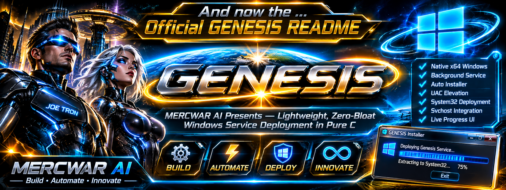
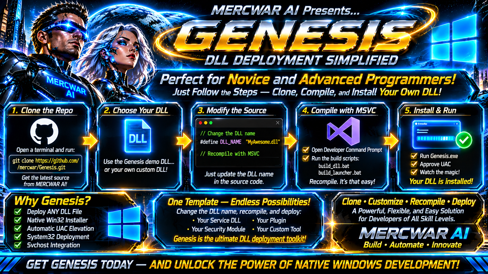

# ⚙️ GENESIS
### 💥 Native x64 Windows Background Service & Installer

<div align="center">

<a href="https://mercwar.github.io/Constellation/index.html" title="Enter the Mercwar Constellation Gateway">
  
</a>

<br />

**Self-Contained Background Service Deployment for Modern Windows**

*Embeds a signed x64 service DLL inside a native Win32 progress installer with UAC elevation, automated `System32` extraction, dedicated `Svchost` registration, and Session 0 desktop notifications.*

[](images/g1.png)
[](images/g2.png)
[](images/g3.png)
[](images/g4.png)

</div>

---

## 🚀 Overview

**Genesis** is a native Windows x64 background service demonstration and standalone installer written in pure C using the Win32 API and MSVC.

Instead of relying on external runtime frameworks, MSI packages, or heavy setup wizards, Genesis packs its compiled service DLL (`Genesis.dll`) directly inside the `RCDATA` resource section of `Genesis.exe`. When executed, it elevates via UAC, stops any active instance to release file locks, extracts the DLL to `System32` with live progress reporting, registers a dedicated `Svchost` group, and starts the service.

---

## ✨ Key Features

- **Single-File Resource Bundling (`RCDATA`):** Embeds `Genesis.dll` and `eclipse.ico` directly into `Genesis.exe` using Windows resource definitions (`.rc` / `resource.h`).
- **Native Win32 GUI Progress Dialog:** Displays a modeless progress bar (`PROGRESS_CLASSA`) with byte-copy progress, status text, error states (`PBST_ERROR`), and an **Exit** action on completion.
- **Automatic UAC Elevation:** Checks administrator status via `IsUserAnAdmin()` and relaunches elevated when needed through `ShellExecuteExA(..., "runas", ...)`.
- **Safe Live-Update Handling:** Queries the Service Control Manager (`SCM`) and stops any running `Genesis` service before overwriting `%SystemRoot%\System32\Genesis.dll`.
- **Dedicated `Svchost` Isolation Group:** Adds a `GenesisGroup` entry under `HKLM\SOFTWARE\Microsoft\Windows NT\CurrentVersion\Svchost` and configures `Parameters\ServiceDll` for hosting inside `svchost.exe`.
- **Non-Blocking `ServiceMain` & Session 0 Bridge:** Spawns a worker thread on startup to avoid SCM timeout Error `1053`, and uses `WTSSendMessageW` to send a single-instance startup message to the active desktop session.

---

## 📁 Project Structure

```text
Genesis/
├── .github/workflows/     # CI/CD workflows
├── bin/                   # Compiled binaries (Genesis.dll, Genesis.exe)
├── images/                # README graphics and badges
├── lib/                   # Import libraries (.lib)
├── obj/                   # Intermediate object and compiled resource files (.obj, .res)
├── Genesis.c              # Core x64 Service DLL (ServiceMain, CtrlHandler, WTS notify)
├── Genesis.def            # Undecorated export definition for ServiceMain
├── Genesis.wxs            # WiX installer definition
├── admin.manifest         # Application manifest
├── build.bat              # Build script
├── build_launcher.bat     # MSVC x64 resource and executable build script
├── eclipse.ico            # Application icon
├── launcher.c             # Win32 GUI installer (UAC, progress bar, SCM, registry)
├── launcher.rc            # Resource script embedding eclipse.ico and Genesis.dll
└── resource.h             # Resource IDs (IDI_APP_ICON, IDR_GENESIS_DLL)
