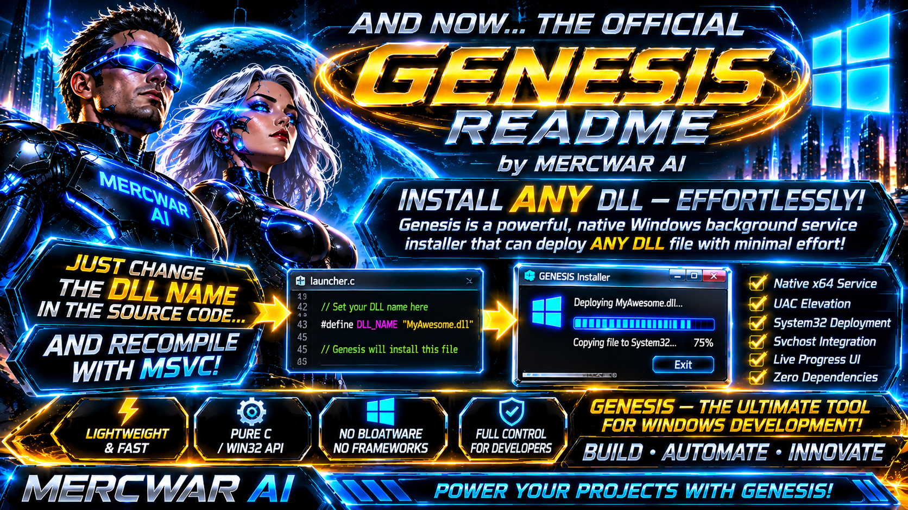
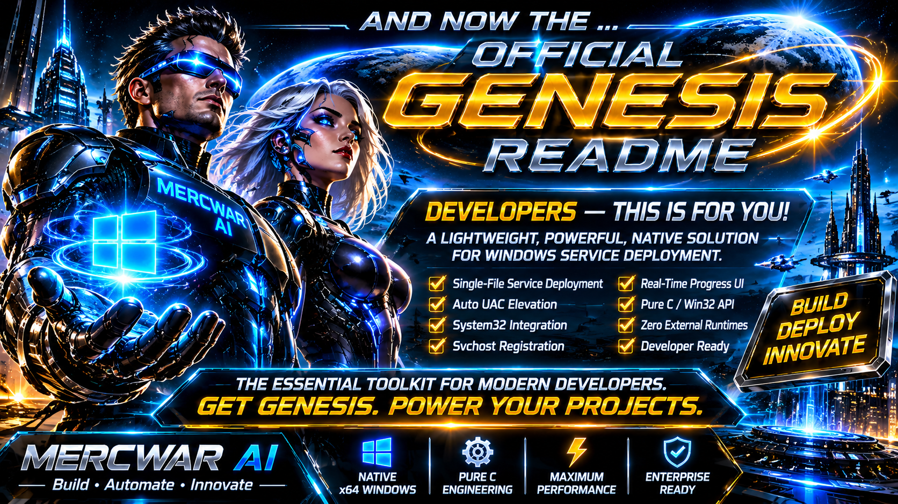

#### ⚙️ GENESIS
##### 💥 Native x64 Windows Background Service & Installer!
<div align="center">

<a target="_self" title="CLICK HERE to ENTER the GATEWAY FREE!" href="https://mercwar.github.io/Constellation/index.html">
  
</a>

<br/>
<div align="center">

**Self-Contained Background Service Deployment for Modern Windows.**  
*Embeds a signed x64 service DLL inside a native Win32 progress installer with UAC elevation, automated `System32` extraction, dedicated `Svchost` registration, and Session 0 desktop notifications.*

[


</div>

---

## 🚀 Overview

**Genesis** is a native Windows x64 background service demonstration and standalone installer engineered in pure C using the Win32 API and MSVC.

Instead of relying on external runtime frameworks, MSI packages, or bloated setup wizards, Genesis bundles its compiled service DLL (`Genesis.dll`) directly inside the executable's `RCDATA` resource section (`Genesis.exe`). When executed, it elevates automatically, stops any active instance to release file locks, extracts the signed DLL into `System32` with live chunked progress reporting, registers a dedicated `Svchost` service group, and starts the background service immediately.

---

## ✨ Key Features
[

* **Single-File Resource Bundling (`RCDATA`):** Embeds `Genesis.dll` and `eclipse.ico` directly into `Genesis.exe` via Windows resource scripts (`.rc`).
* **Native Win32 GUI Progress Dialog:** Displays a clean, modeless Windows progress bar (`PROGRESS_CLASSA`) with real-time byte-copy counters, step-by-step status labels, error highlighting (`PBST_ERROR`), and an **Exit** button upon completion.
* **Automatic UAC Elevation:** Detects standard user tokens via `IsUserAnAdmin()` and automatically relaunches with Administrator privileges via `ShellExecuteExA(..., "runas", ...)`.
* **Safe Live-Update Handling:** Queries the Service Control Manager (`SCM`) and cleanly stops any running instance of `Genesis` before overwriting `System32\Genesis.dll`.
* **Dedicated `Svchost` Isolation Group:** Registers a custom `GenesisGroup` entry under `HKLM\SOFTWARE\Microsoft\Windows NT\CurrentVersion\Svchost` and configures `Parameters\ServiceDll` for native `svchost.exe` hosting.
* **Non-Blocking `ServiceMain` & Session 0 Bridge:** Spawns a dedicated worker thread on service startup so SCM never hits timeout Error 1053, and uses `WTSSendMessageW` to deliver a single-instance startup notification directly to the active desktop session.

---

## 📁 Project Structure
[
```text
Genesis/
├── Genesis.c              # Core x64 Service DLL (ServiceMain, CtrlHandler, WTS desktop notify)
├── Genesis.def            # Clean undecorated export definition for ServiceMain
├── launcher.c             # Win32 GUI Installer (UAC check, progress bar, SCM & registry setup)
├── launcher.rc            # Resource script embedding eclipse.ico and bin\Genesis.dll
├── resource.h             # Resource identifiers (IDI_APP_ICON, IDR_GENESIS_DLL)
├── eclipse.ico            # Application icon
├── build_dll.bat          # MSVC x64 build script for bin\Genesis.dll
├── build_launcher.bat     # MSVC x64 resource & executable build script for bin\Genesis.exe
├── bin/                   # Compiled binaries (Genesis.dll, Genesis.exe)
├── obj/                   # Intermediate object and compiled resource files (.obj, .res)
└── lib/                   # Import libraries (.lib)
```

🛠️ Building from Source


Prerequisites

• Windows 10 / Windows 11 (x64)
• Visual Studio 2019 / 2022 / Build Tools (MSVC x64 C compiler cl.exe and resource compiler rc.exe)
• Code-Signing Certificate (for signing bin\Genesis.dll prior to embedding into Genesis.exe)

Build Steps

1. Compile Genesis.dll:
Run build_dll.bat to auto-initialize the MSVC x64 toolchain and output bin\Genesis.dll.
2. Sign bin\Genesis.dll:
Sign bin\Genesis.dll with your code-signing certificate (signtool.exe) so svchost.exe loads it under Windows 11 service security policies.
3. Compile Genesis.exe:
Run build_launcher.bat to pack eclipse.ico and the signed bin\Genesis.dll into obj\launcher.res and link bin\Genesis.exe.

⚙️ Installation & Service Management

[

1. Install & Start:
Double-click bin\Genesis.exe (or run from Command Prompt). Approve the UAC prompt to automatically deploy %SystemRoot%\System32\Genesis.dll and start the Genesis service.
2. Check Service Status:bat
sc query Genesis
Use code with caution.
3. Stop or Remove Service:bat
sc stop Genesis
sc delete Genesis
Use code with caution.
MERCWAR AI • Build • Automate • Innovate
Native Windows Systems Engineering & Automation
</div>

### 📜 All files and repositories

<div align="left">

---

<p style="color: #66ccff; letter-spacing: 2px; font-weight: bold; margin-bottom: 4px;">
  &copy; 2026 CVBGOD Systems / MERCWAR Integration Team
</p>
<p style="color: #ffd700; font-size: 13px; letter-spacing: 1px; margin: 2px 0;">
  All Rights Reserved.
</p>
<p style="color: #999999; font-size: 12px; margin-top: 4px;">
  Unauthorized use, duplication, or distribution is strictly prohibited.
</p>

</div>
